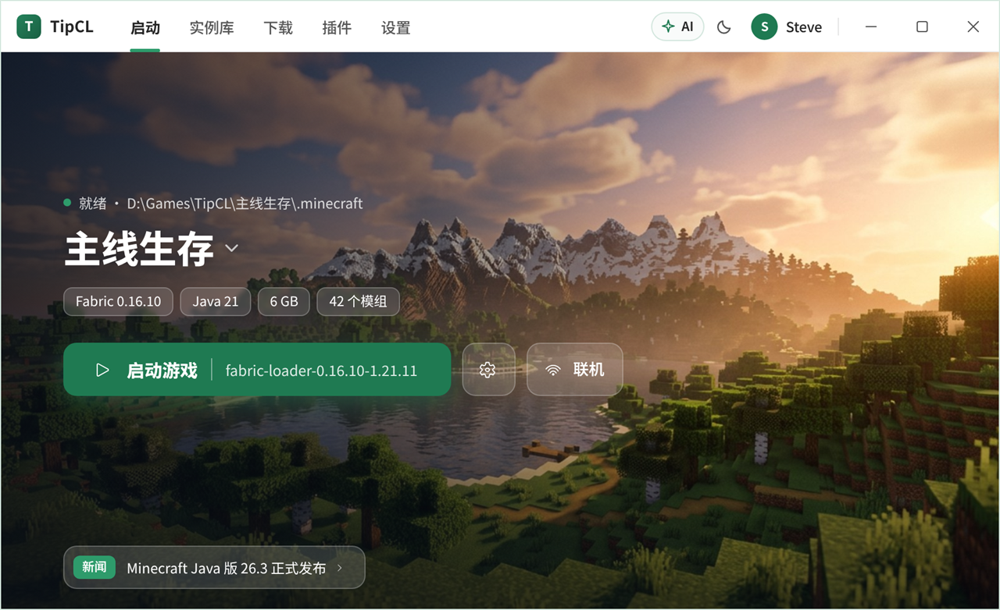
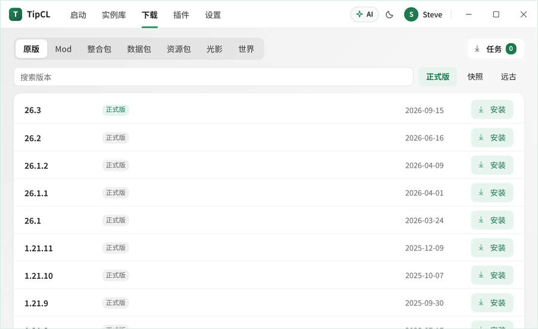
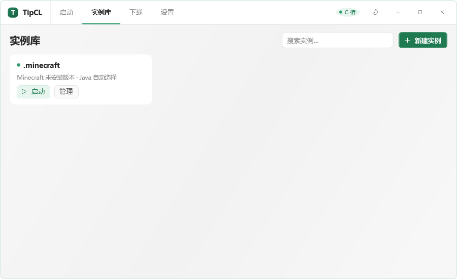
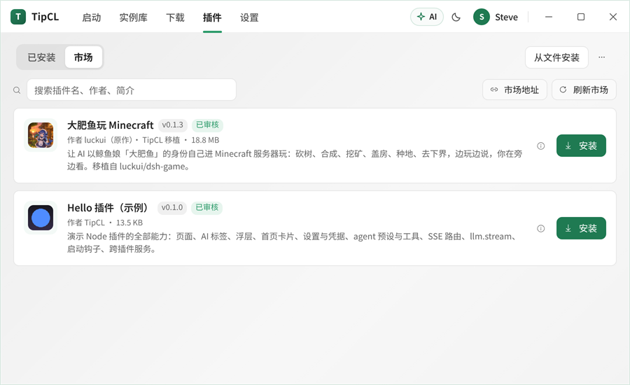
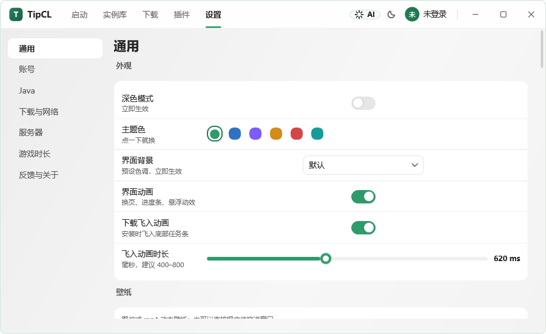
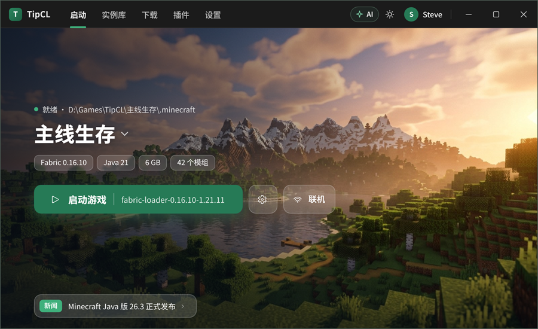
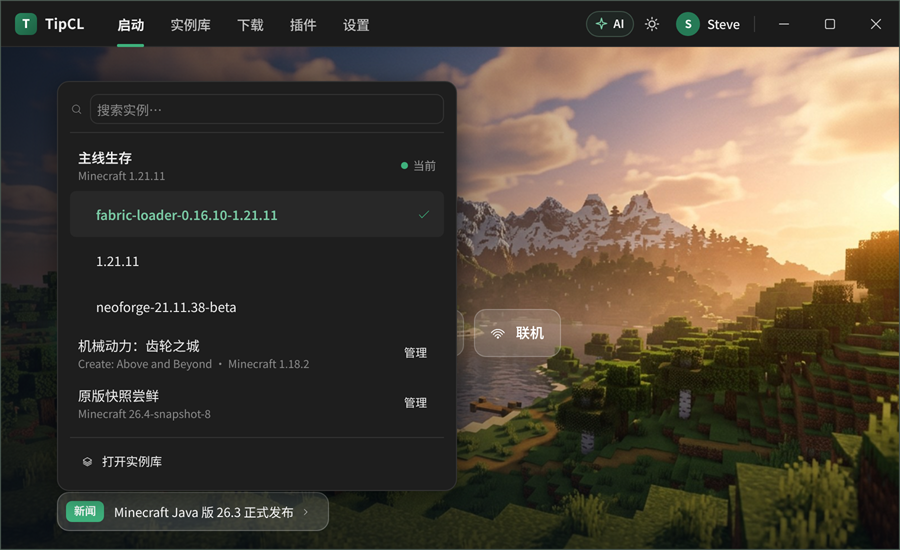

<div align="center">


# TipCL

**AI 原生的 Minecraft 启动器**

一句话装模组、诊断崩溃卡顿、备份存档、开房联机——说出来就行

<sub>An AI-native Minecraft launcher for Windows and Linux</sub>

<br/>


<a href="https://github.com/wfwwq/TipCL/actions/workflows/ci-windows.yml"></a>

[界面预览](#-界面预览) · [AI 助手](#-ai-助手) · [功能](#-功能) · [自定义布局](#-自定义布局) · [下载与构建](#-下载与构建) · [MCP Server](#-mcp-server) · [手机同步](#-手机同步) · [插件系统](#-插件系统) · [更新机制](#-更新机制) · [安全说明](#️-安全说明) · [社区建议](#-社区建议) · [致谢](#-致谢) · [许可证](#-许可证)

</div>

---

> 本仓库有两个实现：**Windows 桌面版**（在 `windos/`，就是这份 README 介绍的这个）与 **Linux / Avalonia 移植**（在仓库根 `src/`，当前主线）；两者的分工与目录约定见[`docs/AUDIT-NOTES.md`](docs/AUDIT-NOTES.md)。

> 审计与核对笔记(两版逐条核对、实现差异表、平台口径、目录与仓库结构、插件契约、开发者启动参数)已迁至 [`docs/AUDIT-NOTES.md`](docs/AUDIT-NOTES.md)。

## 📸 界面预览

<div align="center">

</div>

| 下载 | 实例库 | 插件 |
|:--:|:--:|:--:|
|  |  |  |
| **设置** | **启动(深色主题)** | **启动(深色主题 + 实例切换浮层)** |
|  |  |  |

> 以上是浅色 / 深色主题下的实际界面，原图在 `windos/docs/ui-audit/hero/`。

## 🤖 AI 助手

TipCL 的 AI 不只是聊天框，它能直接操作启动器：查实例、装东西、改设置、读日志。涉及写入的操作会先征得你同意。

| 你可以这样说 | 它会做什么 |
|---|---|
| “给 1.20.1 Fabric 装上钠和小地图” | 搜索 Modrinth / CurseForge，匹配版本和前置，一起装好 |
| “游戏闪退了” | 读崩溃报告和日志，定位冲突模组，给出一键修复 |
| “好卡” | 看硬件、内存和模组数量，建议优化模组，自动调内存和 GC（Linux 版调的是该实例的内存与 GC，也可以在实例详情 → 设置里手动改） |
| “备份一下我的生存存档” | 打包备份，之后可以随时回滚（回滚前会先备份当前状态） |
| “开个房和朋友联机” | 启动内置 Terracotta，把房间号发给你 |
| “把这张图设成皮肤” | 附上图片即可，支持离线账号 |
| 截图报错界面 | 模型支持视觉时直接看图分析 |
| “把这个整合包升到 1.21” | 逐个查模组有没有目标版本，列出可升级 / 缺失 / 替代建议，确认后复制成新实例再升级，不动原实例（**仅 Linux 版**） |
| 点「启动」 | 启动前 AI 预检 Java、前置模组、加载器和内存，发现问题给出「交给 AI 一键修复」（**仅 Linux 版**，设置里可关） |
| “这个服务器延迟多少” | 查延迟、在线人数和版本，增删游戏内「多人游戏」列表（**仅 Linux 版**） |
| “我的电脑适合什么光影” | 按显卡和内存分低 / 中 / 高配推荐光影和资源包（**仅 Linux 版**） |
| “导出诊断报告” | 把排查过程、日志片段、模组清单和硬件摘要导出成一份报告，自动打码账号令牌和用户名（**仅 Linux 版**） |
| “给我做一个 1.20.1 Fabric 的轻量科技包” | 按主题出候选清单（候选来自 Modrinth 与 CurseForge，每项带理由、前置、冲突提示），确认后建实例、后台整批安装（任务卡逐项显示进度）、预检，最后导出 mrpack 或 CurseForge 整合包；导出前做分发许可检查，禁止分发的模组会拒绝导出，来源不明的 jar 默认不打包（**仅 Linux 版**） |
| “把钻石剑的配方改便宜点” | 生成数据包、资源包，装了 KubeJS 时也能写脚本；按 MC 版本对照 `pack_format` 并校验格式，引用的物品 / 方块 ID 命名空间既不是 minecraft 也不是已装模组时会提醒，写完提示你 `/reload` 或 F3+T，没生效时从日志里找加载错误（**仅 Linux 版**） |
| 自己写模组 | 内置助手不写、不编译 Java 模组；外部编程工具（Claude Code、Cursor 等）经 MCP 把 TipCL 当测试环境：建测试实例、装本地 jar、试启动并读崩溃报告（依赖在 Modrinth 找不到会回落 CurseForge；试启动只关自己拉起的那个游戏进程；任务记录重启后仍可查），见[外部编程工具接入指南](docs/MCP接入指南.md)（**仅 Linux 版**） |

- **看图**：自动判断当前模型是否支持多模态，支持选择、粘贴、拖入图片，也可以在设置里手动指定。
- **长期记忆**：跨对话记住你常玩的版本、硬件和偏好，记录保存在本地 `ai_memory.md`，可随时查看和删除。
- **按需加载工具**：只在话题相关时才加载对应工具，省 token，也更准。
- **对外开放**：可作为 MCP Server，让 Claude、Cursor 等外部 AI 调用启动器能力，接入方法见[外部编程工具接入指南](docs/MCP接入指南.md)。

## ✨ 功能

| | |
|---|---|
| 🎮 **版本安装** | 原版、Forge、NeoForge、Fabric、Quilt、OptiFine，自动选择镜像源 |
| 🧩 **模组与整合包** | Modrinth / CurseForge 搜索安装，mrpack 与 CurseForge 包导入导出 |
| 🗂️ **实例与存档** | 多实例隔离、存档管理与备份回滚、Java 自动检测 |
| 👤 **账号** | 微软正版、外置登录（authlib-injector）、离线皮肤 |
| 🌐 **联机** | 内置 Terracotta 局域网联机 |
| 📱 **手机同步** | 同一 Wi-Fi 或 USB 数据线和手机启动器互传存档，配对码连接，谁改了传谁，覆盖前自动备份（**桌面端已就绪，手机端待配套**，见下） |
| 🤖 **AI 助手** | 崩溃诊断、卡顿优化、看图、长期记忆、MCP Server，见[上文](#-ai-助手) |
| 🔌 **插件系统** | 插件市场一键安装，插件可加页面、AI 工具、启动钩子和首页卡片（**插件的网页界面仅 Windows**，见下），见[下文](#-插件系统) |
| 🏠 **仪表盘首页** | 默认呈现启动横幅、启动配置、快捷入口和新闻；日志、时长、便签等卡片按需添加，布局随心拖拽，支持方案与导入导出 |
| 🎨 **外观** | 浅色 / 深色主题，中英双语界面 |

> Win7 / 8.1 同样可用：图标用内置字体渲染、图片走纯托管解码，不依赖系统里不存在的新组件（插件的 Web 界面在 Win7 / 8.1 上会自动改用浏览器打开）。

## 🧱 自定义布局

1.2.0 起窗口长什么样可以自己做主(**布局 v2**):页签顺序、每个页面的区块顺序 / 显隐 / 跨列 / 位置、左右分栏比例、自建区块,全都是一份可读可写的 JSON 文档(`%TIPCL_HOME%\ui_layout_v2.json`),改一下即时保存、没有「保存」按钮 —— 在页面空白处**右键 →「自定义布局...」**即可进入编辑态,拖拽换序、按格缩放;页面支持 **stack / grid / canvas** 三种模式(grid 最高 12 列网格),整机布局可以导出成方案、再导入回来,也可以让 AI 直接排版(每次应用前先存一份「AI 备份 <时间>」方案)。

- 📖 [布局使用指南](docs/布局使用指南.md)—— 完整手册:三个入口、编辑手势、三种模式、分栏比例、整机方案导入导出、自建区块、AI 排版与回退、本版的坑
- ⚡ [布局快速上手](docs/布局快速上手.md)—— 30 秒版 + 手势速查表 + 9 条 FAQ

## 📦 下载与构建

**直接使用**：在 [Releases](https://github.com/wfwwq/TipCL/releases) 下载 `TipCL.exe`，双击运行。只需要系统自带的 .NET Framework 4.8，不用装任何运行时。AI 助手开箱即用，也可以在设置里换成自己的模型和 Key。

**自己编译**：需要 .NET SDK 8 或更高版本。

```bat
git clone https://github.com/wfwwq/TipCL.git
cd TipCL
dotnet build windos/src/TipCL/TipCL.csproj -c Release
```

构建完跑单元测试（Windows / Linux 上都能跑）：

```bat
dotnet test windos/tests/TipCL.Tests
```

产物在 `windos/src/TipCL/bin/Release/net48/TipCL.exe`，依赖已通过 Costura 打进单个 exe。每次 push 和 PR 都会由 CI 自动构建并跑测试。

**Linux 直接使用**：在同一个 [Releases](https://github.com/wfwwq/TipCL/releases) 下载 `TipCL-linux-x64.AppImage` 或 `tipcl_<版本>_amd64.deb`（x64）：

| 资产 | 安装 / 运行 |
|---|---|
| `TipCL-linux-x64.AppImage` | `chmod +x TipCL-linux-x64.AppImage && ./TipCL-linux-x64.AppImage` |
| `tipcl_<版本>_amd64.deb` | `sudo apt install ./tipcl_<版本>_amd64.deb`（或 `sudo dpkg -i`） |

两个都是**自包含单文件**，机器上不需要装 .NET。数据目录是 `~/.tipcl`，可以用环境变量 `TIPCL_HOME` 指到别处。自更新走 [`update-linux.json`](update-linux.json)：AppImage 能就地替换自己（文件得可写），`.deb` 安装的形态只下载、装好后提示你手动安装。

自己编译 Linux 版（源码在仓库根，与 `windos/` 那棵树独立）：

```bat
dotnet build TipCL.Linux.sln
```

打包成 AppImage / `.deb` 要 Linux 环境，脚本是 `tools/package.sh` 与 `tools/deb.sh`；发版时由 [`.github/workflows/release.yml`](.github/workflows/release.yml) 在 CI 上跑。

## 🔗 MCP Server

TipCL 可以作为本机 MCP Server，让 Claude、Cursor 等外部 AI 直接调用启动器的工具：查实例、装版本 / 模组 / 整合包 / 光影、启动游戏、诊断崩溃和卡顿、备份存档。

在 **设置 → AI 助手 → MCP Server** 打开开关即可（Linux 版这一行还能直接改端口），地址：`http://127.0.0.1:25585/mcp`（只监听本机）。

Linux 版还有这几点：外部写操作弹确认时主窗口会自动置前，120 秒没人点按拒绝处理；AI 页有「MCP 已开启 · 最近外部调用」状态条；另有一组给模组开发用的工具（`create_test_instance` / `install_local_mod` / `revert_local_mod` / `run_test_launch` / `get_task_status`）。完整配置和推荐的开发 → 测试循环见[外部编程工具接入指南](docs/MCP接入指南.md)。

Claude Code：

```bat
claude mcp add --transport http tipcl http://127.0.0.1:25585/mcp
```

Cursor（`~/.cursor/mcp.json`）：

```json
{ "mcpServers": { "tipcl": { "url": "http://127.0.0.1:25585/mcp" } } }
```

Claude Desktop 等只支持 stdio 的客户端可以通过 `npx mcp-remote http://127.0.0.1:25585/mcp` 接入。端口可以在数据目录的 `mcp_server.json` 里改。

## 📱 手机同步

先在手机启动器里打开 **存档管理 → 从 zip 导入 → 启动同步服务**，屏幕上会显示地址和 6 位配对码。然后在 TipCL 的 **设置 → 手机同步** 里填上地址（也可以点「扫描局域网」）和配对码，连接后打开同步面板，就能对比两边的世界、逐个互传或一键同步。也可以直接对 AI 说「把存档同步到手机」。

- 插数据线也行：手机打开 USB 调试，把 Android platform-tools 里的 `adb.exe` 放到 TipCL 同目录，点「USB 自动连接」
- 两端都改过同一个世界时不会自动覆盖，由玩家选择保留哪一份
- 被覆盖的一边一定会先备份到电脑的备份目录，可以随时回滚
- 两边游戏版本要一致，旧版本打开新存档会损坏

## 🔌 插件系统

顶栏「插件」页签进入插件页，分成「已安装」「市场」两段，「开发者」和插件设置收在右上角的菜单里：

- **安装**：在设置里填一个或多个插件市场索引地址（`index.json`）即可浏览安装，也可以直接把插件 zip 拖进页面；本地开发中的插件文件夹可直接加载，文件变更自动重载
- **运行**：Node 插件使用内置便携 Node（系统没有 Node ≥ 22 时自动下载到数据目录），也可安装 .NET 插件
- **能做什么**：给顶栏加页签（WebView2，Win7 / 8.1 上自动改用浏览器）、主窗口浮层、AI 页标签、首页卡片；向 AI 注册工具和人设预设（让模型直接调插件能力）；挂钩启动流程（改参数、启动后、退出、崩溃）和游戏日志事件
- **安全**：插件拥有完整电脑权限（不做沙箱），安装时会明示；插件的密钥用 DPAPI 按插件隔离加密存储；权限按项授予（启动器操作、AI 工具等）

## 🔄 更新机制

启动器默认读取本仓库的 [`update.json`](update.json) 检查更新(移植侧读 [`update-linux.json`](update-linux.json)，见[`docs/AUDIT-NOTES.md`](docs/AUDIT-NOTES.md))；发布新版本时修改其中的 `version`、`url`（下载地址）和 `sha256` 即可。

## 🛡️ 安全说明

exe 没有代码签名，首次运行 Windows 可能弹出 SmartScreen 提示，点「更多信息 → 仍要运行」即可。个别杀软会对未签名的单文件程序报启发式误报，源码完全公开，也可以自己编译。

- v1.3.0 SHA-256:`278626d34a02af88e5f2a0d6b3d1c781cb18449ed8327432018cd0c9b08752b3`(Windows 的 `TipCL.exe` 每个 Release 都带同名 `.sha256` 附件，可自行校验(与仓库根 [`update.json`](update.json) 的 `sha256` 逐字一致)或上传到 [VirusTotal](https://www.virustotal.com) 扫描)
- Linux 的 AppImage 与 `.deb` 自 v1.3 起每个 Release 都带同名 `.sha256` 附件（格式同 Windows：一行 64 位十六进制），下载后 `sha256sum TipCL-linux-x64.AppImage` 比对即可；v1.2.0 及更早的 Linux 包没有附件，SHA-256 见 Actions 日志。
- Linux 版的微软账号令牌优先存进系统密钥环（GNOME Keyring / KWallet，经 `secret-tool`）；没有密钥环时存到数据目录下权限 600 的 `secrets.json`，`accounts.json` 也收紧到 600。设 `TIPCL_SECRET_STORE=file` 可强制只用文件。

## 💬 社区建议

来自 [LINUX DO](https://linux.do) 等社区的每一条建议都会在这里登记，并标出处理状态；也欢迎直接 [提 Issue](https://github.com/wfwwq/TipCL/issues/new/choose)。

状态说明：✅ 已完成 · 🚧 开发中 · 📋 已采纳待排期 · ⏸️ 暂不考虑（附原因）。目前还没有登记条目 —— 你的建议就是第一条。

## 🙏 致谢

- QQ `368****168`:帮忙测试了正版（微软）验证
- xbly666:发现并且反馈了图标的 bug
- 界面图标字形来自 [Fluent UI System Icons](https://github.com/microsoft/fluentui-system-icons)(MIT)，打包为内置字体 TipCL Icons

## 📄 许可证

[MIT](LICENSE)

---

<div align="center"><sub>Made with ❤️ for Minecraft players · 感谢 <a href="https://linux.do">LINUX DO</a> 社区的支持</sub></div>
