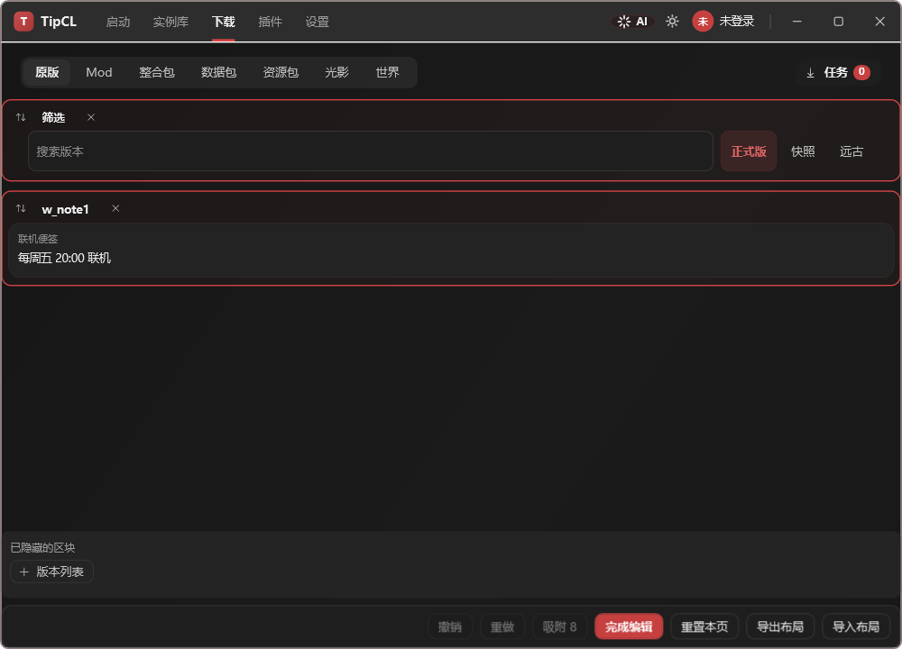
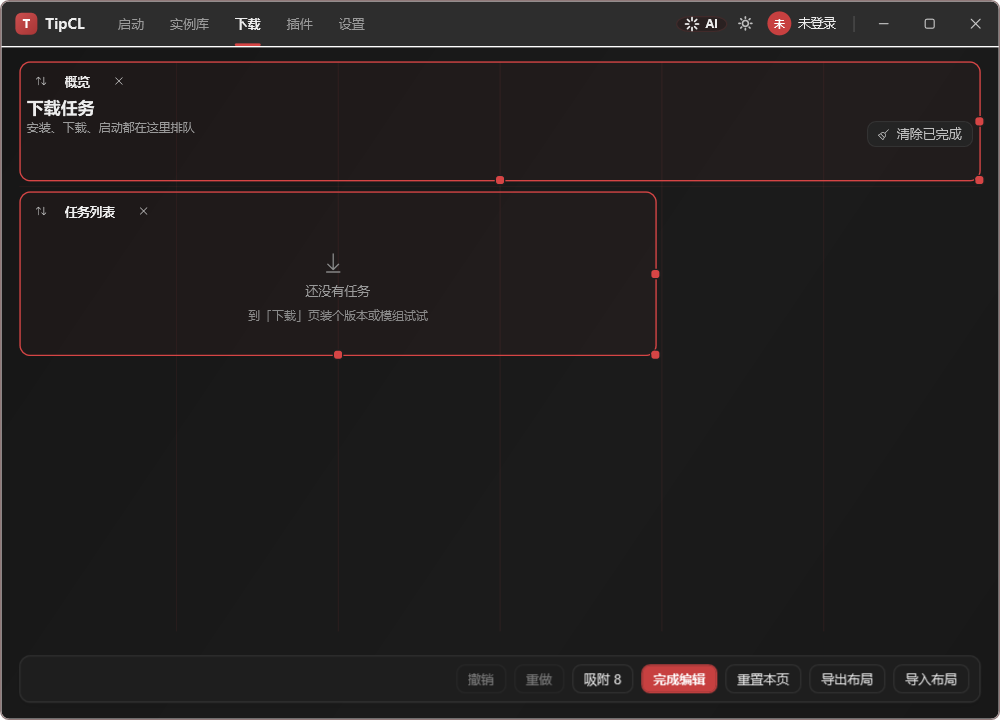
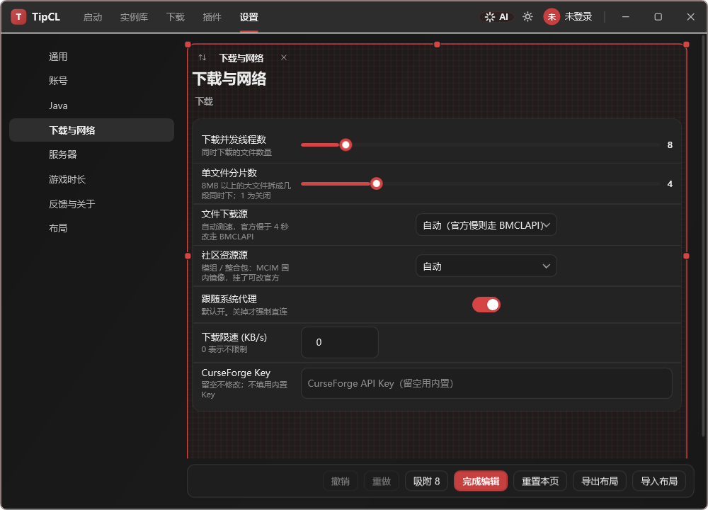
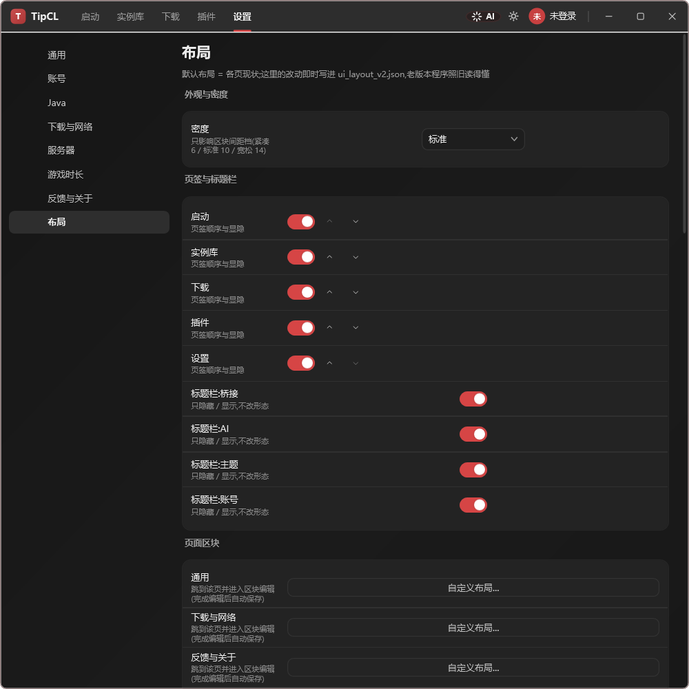
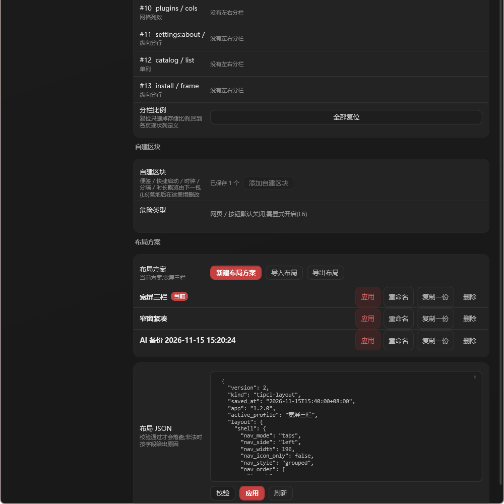

# TipCL 布局 v2 使用指南(1.2.0)

面向使用者的**完整手册**:布局 v2 是什么、三个入口在哪、编辑态怎么手势、三种模式怎么选、
分栏怎么调、整机方案怎么导入导出、自建区块怎么加上、AI 排版改坏了怎么回退、本版的坑在哪。

本手册只写**代码里确实存在的行为**,每条结论都在 `windos/src/TipCL/**` 里核到具体行号(见文末
「事实来源」表)。文里出现「未实测」的地方,表示结论是从代码读出来的、没有在真机上点一遍。

> **平台范围(必读,2026-11-20 复核)**:本手册写的是 **Windows 桌面版**(`windos/src/TipCL/**`,exe
> `TipCL-1.2.0-premium-39056c8.exe`,外加 2026-11-19 替换后的那个 v1.2.0 附件)。**Linux 移植树**
> (仓库根 `src/TipCL.App`)已落地布局 v2 的文档 / 引擎 / 编辑器 / 右键「自定义布局...」入口 / 自建区块渲染,
> 设置页整页「布局」视图(7 小节)、分栏比例界面、整机方案、布局 JSON 卡片、页签与标题栏编辑也已在 Linux 树;
> **唯一还缺的是 AI 排版工具**(`layout_apply` 与「AI 备份 <时间>」方案,只在 `windos/`,Linux 树零命中),
> 所以本文「AI 排版」「AI 回退」两节对 Linux 版不适用。
> (清单见 [docs/README.md](README.md) 的「布局 v2:Linux 移植版的真实进度」)
> 另外:Windows 开发通道的 `--shot / --size / --theme` 在 Linux 树**不存在**——`--smoke` 分支不解析参数,
> 带上会被**静默忽略**(实测 exit 0),Linux 侧要选页 / 选主题请用 `SMOKE_PAGE` / `SMOKE_DARK`。

想先看短版(30 秒版 + 速查表 + FAQ)看同目录的 [布局快速上手.md](布局快速上手.md),那份是"想干什么 →
怎么点";这份是"为什么是这样、边界在哪"。

---

## 1. 一句话:布局 v2 是什么

**你的窗口长什么样(页签顺序、每个页面的区块顺序/显隐/跨列/位置、左右分栏比例、自建区块),
现在是一份可读可写、可以整体带走或塞回来的 JSON 文档。**

- 文档放在 `%TIPCL_HOME%\ui_layout_v2.json`(`LayoutStoreV2.FileName`,写入位置由
  `LauncherPaths`/`BridgeHost.FindRoot()` 决定;见 `Core/Launcher/Layout/LayoutStoreV2.cs:18`、
  `:50-76`)。
- 文档外壳:`kind = "tipcl-layout"`、`version = 2`(`Core/Launcher/Layout/LayoutSchema.cs:13,16`)。
- 正文分六块:`shell` / `pages` / `splits` / `widgets` / `variants` / `meta`
  (`Core/Launcher/Layout/LayoutDocV2.cs:353-402`)。
- **改动是即时保存的**,没有「保存」按钮。编辑态里拖一下就落盘,「完成编辑」只是退出编辑态并提示
  「布局已保存」(`Pages/Layout/LayoutEditor.cs:291` 附近的 `ExitEdit`;落盘走 `Persist`
  `:685`,最终调 `LayoutEngine.ApplyPage` `Pages/Layout/LayoutEngine.cs:719`)。
- **撤销栈只在本次编辑态里有效**:再进编辑态会清空历史(`LayoutEditor.EnterEdit`
  `Pages/Layout/LayoutEditor.cs:267-288`,`_session.ClearHistory()`),但因为改动早就写进文档了,清空
  历史**不会**回退你的改动。

一句话总结:**v2 文档是真源,窗口是它的投影。** 老版本读的 `ui_page_layouts.json`(v1)现在只作为
「迁移来源 / 兼容导出」存在——本版启动时会读 v1 并升级成 v2(`LayoutStoreV2.LoadMigrating`
`:122-146`),之后就以 v2 为准。

---

## 2. 三个入口:怎么进编辑态

| 入口 | 怎么进 | 适用页面 | 代码出处 |
|---|---|---|---|
| ① 页面右键菜单 | 在页面空白处**右键 →「自定义布局...」** | 该页有 **2 个以上**区块时才出现这一项 | `Pages/BlockHost.cs:42-69`(门槛 `specs.Count >= 2`) |
| ② 设置页入口按钮 | **设置 → 布局 →「页面区块」**,点那一页右边的「自定义布局...」 | 全仓 12 个宿主页都列在这张表里,**单块页(下载与网络 / 反馈与关于)也能进** | `Pages/SettingsLayoutPage.cs:229-281`(入口表 `LayoutBlockEntryCatalog.All` `:807-890`)、`Pages/Layout/LayoutEditor.cs:230-236`(`CanEdit` = `specs.Count >= 1`) |
| ③ 编辑器内 | 已经在编辑态时,底部工具条提供「重置本页 / 导出布局 / 导入布局」 | 任何页面 | `Pages/Layout/LayoutEditor.cs:133-171` |

两个入口的门槛**故意不一样**,这不是 bug:

- 右键菜单按 `specs.Count >= 2`:单块页上「自定义布局」是个没有意义的菜单项(连"顺序"都没有),
  所以不出现(`Pages/BlockHost.cs:53-56` 的注释写明了这一点)。
- 设置页按钮按 `LayoutEditor.CanEdit`(`>= 1`):单块页**能**调外观 / 标题 / 先隐藏,只是不能重排
  (`Pages/Layout/LayoutEditor.cs:229-236`)。

**入口 ② 的页面清单**(`LayoutBlockEntryCatalog.All`,`Pages/SettingsLayoutPage.cs:807-890`)
——共 12 个宿主,设置页里 7 个 + 顶栏导航 5 个:

设置页内:`settings:general`(通用)、`settings:network`(下载与网络,**单块**)、
`settings:about`(反馈与关于,**单块**)、`java`、`servers`、`playtime`、`feedback`;
顶栏导航:`launch`、`download`、`account`、`tasks`、`multiplayer`。

> 注意:点入口 ② 会**先跳到那个页面**(设置页内的先切到对应视图)再进入编辑态,所以你会看到窗口
> 切走了——这是设计如此(`SettingsLayoutPage.cs:229-281` 的 `OpenBlockEditor`/`EnterBlockEdit`)。

### 编辑态长什么样

- 底部出现**悬浮工具条**:`撤销 / 重做 / 吸附 N / 完成编辑 / 重置本页 / 导出布局 / 导入布局`
  (`Pages/Layout/LayoutEditor.cs:134-164`)。
- 底部出现「**已隐藏的区块**」托盘:被隐藏的块以「+ 标题」chip 呈现,点一下恢复
  (`Pages/Layout/LayoutEditor.cs:126-132`)。
- 每个块顶部长出一条**操作条**:左边拖拽手柄 `⋮⋮`、中间块标题、右边 `✕`(隐藏)
  (`Pages/Layout/LayoutEditor.cs:1426-1484` 附近的 `LayoutCard` 组装)。



**这张图看什么**(下载页,stack 编辑态,深色):每个块顶部的操作条(左侧 `⋮⋮` 拖拽手柄、标题、右侧
`✕`),底部「已隐藏的区块」托盘里的 `+ 版本列表` chip(说明版本列表当前是隐藏的,点它恢复),以及右下
角工具条上的「吸附 8」/「完成编辑」。图里第二个块是本手册测试时放进文档的一份自建便签块:它的**内容**里
显示 `联机便签 / 每周五 20:00 联机`(来自 `widgets[]` 的 `title` 与 `settings.text`),而它的**操作条标题**
显示的是原始块 id `w_note1`——因为没有页面 spec 的自建块,操作条标题就按块 id 派生
(`LayoutEditor.SpecOf` `:543-565`)。录制方式见文末「本手册的截图怎么来的」。

---

## 3. 编辑态手势与键盘

| 动作 | 怎么做 | 代码出处 |
|---|---|---|
| 换顺序(stack) | 拖操作条上的**拖拽手柄**:块**浮起来跟手**,指针越过相邻块中点 **±6px** 才换位(滞回,手抖不换),其余块 **170ms** 滑到新位置,松手后 **170ms** 滑进格子 | `LayoutEditor.cs:1598`(`BeginDrag`)、`:1709`(`MoveStackFloat`)、`:1720`(`ApplyStackReorder`);阈值 `StackDragPlan.cs:21`(`Hysteresis = 6.0`) |
| 移动块(grid) | 直接拖**块**:位移折算成"格",整格移动,不会停在半格 | `LayoutEditor.cs:865`(`BeginBoxDrag`)、`LayoutEngine.cs:985`(`LayoutGrid.Pack`) |
| 移动块(canvas) | 直接拖块:自由定位,按当前吸附档对齐 | `LayoutEditor.cs:865`、`LayoutEngine.cs:2551`(`Nudge` 的同一套吸附格) |
| 拖缩放手柄(grid) | 只有**右下三个**:`e` 右 / `s` 下 / `se` 右下 | `LayoutEditor.cs:1539-1552`(`UpdateHandles`,grid 只让这 3 个可见)、`:1464-1472`(手柄层与 8 个手柄的创建) |
| 拖缩放手柄(canvas) | **八个方向**:四角 + 四边 | `LayoutEngine.cs:1446`(`HandleNames` = nw,n,ne,w,e,sw,s,se)、`LayoutEditor.cs:1554-1594`(`AddHandle`/`HandleCursor`) |
| 多选 | `Ctrl` 或 `Shift` + 点块(点一下选中,再点取消) | `LayoutEditor.cs:864-877`(拖拽时按住 Ctrl/Shift = 只改选择) |
| 框选 | 在空白处按住拖出选框:框到谁选谁,**先清掉原来的选择** | `LayoutEditor.cs:110` 附近的 `_box`;`BeginBoxDrag` `:865` |
| 对齐辅助线 | 拖动中与其它块的左/右/上/下/中线比对,**差 4px 以内**磁性吸附并画线 | `LayoutEngine.cs:1737-1756`(`LayoutGuides.Threshold = 4.0`) |
| 隐藏某块 | 点操作条右侧 `✕`;恢复:点底部托盘里那个 chip | `LayoutEditor.cs:126-132`、`:1426-1484` |
| `Esc` | 正在框选 → 只取消本次框选;否则**退出编辑态** | `LayoutEditor.cs:1197-1216`(`OnEditorKeyDown` → `LayoutEditSession.KeyOf` `LayoutEngine.cs:2501`) |
| `Delete` / `Backspace` | 只删**自建块(`custom:`)与插件块(`plugin:`)**:删内置块会提示「内置区块不能移除」 | `LayoutEditor.cs:1247-1271`(`DeleteSelection`)、`:1271`(提示文案)、`LayoutEngine.cs:574-628`(`Classify`/`IsImplicitRef`) |
| 方向键 | 微调:`grid` 按"格"、`canvas` 按"吸附格";按住 `Shift` = 10px 档 | `LayoutEditor.cs:1283-1300`(`NudgeSelection`)、`LayoutEngine.cs:2551-2603`(`Nudge`) |
| `Ctrl+Z` / `Ctrl+Y`(`Ctrl+Shift+Z` 亦可) | 撤销 / 重做 | `LayoutEngine.cs:2501-2545`(`KeyOf`)、`LayoutEditor.cs:1227-1232` |
| `Ctrl+C` / `Ctrl+V` | 复制:有选中就复制选中的块,没选中就**复制整页**;粘贴到本页末尾,按 id 去重 | `LayoutEditor.cs:1345-1365`、`LayoutEngine.cs:2501-2545` |
| 「吸附 N」 | 切换画布吸附档:循环 `0 → 4 → 8 → 16 → 24`,**默认 8** | `LayoutEditor.cs:454-471`(`CycleSnapStep`)、`LayoutEngine.cs:1443`(`Steps`) |

三个容易踩的点:

1. **多选和框选只在 grid / canvas 有效**。stack 页没有自由坐标,只能拖手柄换序(见 §4)。
2. **缩放手柄只在 grid / canvas 出现**。stack 页看到的那个手柄是"换序手柄",不是缩放。
3. **「吸附 N」管的是 canvas 栅格吸附档**(默认 8px),和拖动时的 **4px 对齐辅助线** 不是一回事
   (阈值常量 `LayoutEngine.cs:2264-2267` 的 `LayoutGuides.Threshold = 4.0`;吸附档 `LayoutEngine.cs:1950` 的 `Steps = {0,4,8,16,24}`)。

### 3.1 拖动手感(2026-11-20 改版后的精确口径)

R3 把 stack 纵向拖拽从"交换即落位"改成"浮起 + 滞回 + FLIP + 落位收敛",边缘自动滚动也从"跟着鼠标事件推固定像素"改成计时器驱动。**这些数是契约,不是随手写的**:

| 项 | 口径 | 出处 |
|---|---|---|
| 浮起 | 抓住后卡片按**像素**跟手(只改 `RenderTransform`,每帧零布局) | `LayoutEditor.cs:1661-1707`、`MoveStackFloat()` `:1709` |
| 换位滞回 | 必须越过相邻块中点 **±6px** 才换位;换位后把"格子位移量"补偿回卡片,让它停在你手指下不瞬移 | `StackDragPlan.cs:20-50`(`Hysteresis = 6.0`)、`LayoutEditor.cs:1666-1668` |
| 让位动画 | 其余块用 **170ms** ease-out 三次曲线从旧位置滑到新位置(FLIP;偏移算上未走完的动画当前值,连着换位也不跳) | `LayoutMotion.cs:16`(`FlipMs = 170`)、`LayoutMotion.cs:78-81`(`FlipOffset`)、`LayoutEditor.cs:1753`(`FlipStackCards`) |
| 落位 | 松手后从"手指位置"**170ms** 滑回自己的格子;位移 < 0.5px 不动画 | `LayoutMotion.cs:19,25`(`SettleMs = 170`、`MinOffset = 0.5`)、`LayoutEditor.cs:1831`(`StartStackSettle`)、`:1899`(`EndDrag`) |
| 边缘自动滚动 | **16ms** 一帧;边缘区 **36px**(不超过视口高的 1/3);每帧步长 `(0.25 + 0.75×深度) × 18px`,越靠边越快;指针停住也继续滚,而且滚动的位移会折回指针的内容坐标,落点跟着走 | `LayoutEditor.cs:157-172`(计时器与注释)、`:1858-1888`(`AutoScrollNearEdgeStack`)、`StackDragPlan.cs:73-99`(`EdgeScrollStep`) |
| 关掉动画时 | `Motion.Enabled = false` 或非单列 → 退回原来的"交换即落位",行为与改版前逐像素一致 | `LayoutEditor.cs:1691-1697`、`:1652-1658` |

> 只想知道"我怎么拖":抓住手柄上下拖,块会跟着鼠标走;**推得不够不会换位**,推够了旁边那块会自己让开;拖到页面上下边缘会自动滚;松手那块自己滑进格子。



**这张图看什么**(`download` 页,grid 模式,`cols = 6`,深色):背景的**栅格底纹**就是 6 列;上面那块
「概览」跨满 6 列,下面那块「任务列表」只占左边 4 列,右侧留空——这就是 **`span` 的直观效果**;两块右边
只有 `e` / `s` / `se` 三个缩放手柄,没有左边和上面的手柄。

---

## 4. 三种模式:stack / grid / canvas

模式是**每页独立**的字段(`pages.<pageId>.mode`),取值只有 `stack` / `grid` / `canvas`
(`Core/Launcher/Layout/LayoutSchema.cs:21,24,27`;校验见 `SettingsLayoutPage.cs:1476-1483`)。

| 模式 | 排布方式 | 页级参数 | 手柄 | 什么时候用 |
|---|---|---|---|---|
| `stack`(**默认**) | 单列纵向流,靠**换序手柄**上下换位置 | `cols` 只在显式写 2 或 3 时生效,其余(含默认 12)一律单列 | 换序手柄 | 你只想调顺序和显隐 |
| `grid` | 6 列 / 12 列…的栅格,**按 span 打包** | `cols ∈ {2,3,4,6,12}`(**只认这五个值**,别的会被吸附) | 右 / 下 / 右下 3 个 | 一行想放两块、想控制跨列宽 |
| `canvas` | 归一化矩形(x/y/w/h ∈ 0..1)自由摆放 | 页级 `gap`、每块 `min_h` | 八个方向 | 想做成"桌面"式自由拼贴 |

补充要点:

- **默认是 stack,而且默认渲染与"没有布局功能"的老版本逐像素一致**——这是刻意的:stack 模式的宿主
  根本不进可视树(`Pages/Layout/LayoutEditor.cs:180-184` 的注释)。
- stack 的"多列"有额外门槛:`cols ∈ {2,3}` 才多列,写 `cols = 6` 而 `mode = stack` 仍然是单列
  (`LayoutEngine.cs:643-666` 的 `StackColumns`)。
- grid 的**打包**是按顺序的:能放进当前行就放,放不下就换行——所以"跨列"靠的是 `span`,不是坐标
  (`LayoutEngine.cs:985-1047` 的 `LayoutGrid.Pack`)。
- canvas 的尺寸/位置都会被**钳位**:`w/h ∈ [0.04, 1]`、`x/y ∈ [0, 1]`
  (`LayoutSchema.cs:140-146`,钳位实现 `Core/Launcher/Layout/LayoutSchema.cs:555-584` 的
  `SanitizeBlock`)。
- canvas 的最小尺寸有兜底常量:`FallbackMinW = 200`、`FallbackMinH = 120`、`DefaultStep = 8`、
  `RefHeight = 600`、`HandleSize = 11`(`LayoutEngine.cs:1422-1434`)。

### 怎么切换模式

**界面上没有"模式"下拉框**——这是本版的设计。切换只有两条路:

1. **设置 → 布局 →「布局 JSON」卡片**:把 `pages.download.mode` 从 `"stack"` 改成 `"grid"`,
   点「校验」看提示,再点「应用」(校验无硬错误才会落盘;`Pages/SettingsLayoutPage.cs:1349-1365`
   的 `LayoutJsonEditor.Apply`,`kind`/`version` 缺失或不对是**硬错误**,会拒绝应用 `:1285-1301`)。
2. **AI 排版**:让 AI 调 `layout_apply` 的 `mode` 参数(`Core/Launcher/Ai/LayoutTools.cs:275-277`)。

**可粘贴的最小例子——把「下载」页改成 6 列栅格,并让"版本列表"只占 4 列:**

```json
{
  "version": 2,
  "kind": "tipcl-layout",
  "layout": {
    "pages": {
      "download": {
        "version": 2,
        "mode": "grid",
        "cols": 6,
        "gap": 10,
        "blocks": [
          { "id": "filters", "span": 6 },
          { "id": "list", "span": 4 }
        ]
      }
    }
  }
}
```

- `kind` / `version` 顶层字段**不能省**(硬错误);
- 页面里 `blocks` 只需要写你要改的块,**没写到的块沿用文档里的现状**;
- `span` 超过 `cols` 会被夹到 `cols`;
- 「下载」页的两个块 id 是 `filters` / `list`(`Pages/DownloadPage.cs:117-120` 的 `BlockHost` 声明);
  「下载任务」页是 `header` / `list`(`Pages/TasksPage.cs:61-64`)。

> 上面这段例子是拿产品自己的校验器跑过的(零错误零警告):把 JSON 喂给
> `LayoutJsonEditor.Inspect` 后,解析结果是 `mode = grid`、`cols = 6`、`filters.span = 6`、
> `list.span = 4`——**字段原样保留**,不会被改写或丢弃。本手册的三段 JSON 例子都这么验过。

---

## 5. 分栏比例(左右两栏怎么调)

**先记住一个数字:界面上共 13 处分栏,其中只有 6 处是"左右两栏"、能拖。** 你在别的页面找不到分隔条
是正常的(现状表来自 `SplitCatalog.All`,`Pages/Layout/PageLayoutHost.cs:101-289`;测试固化了这个数字:
`windos/tests/TipCL.Tests/LayoutSplitTests.cs:92` 断言 `TwoColumnCount() == 6`)。

| # | 页面 / 分栏 | 拖的是哪一栏 | 现状 |
|---|---|---|---|
| 1 | `account` / `hero` | 头像卡 | 240px |
| 2 | `ai` / `history` | 历史栏 | 220px |
| 3 | `feedback` / `side` | 右侧卡片 | 360px |
| 4 | `library` / `folders` | 文件夹栏 | 星号比例 1/3 |
| 5 | `settings` / `nav` | 左侧导航 | 168px |
| 6 | `version-manage` / `nav` | 左侧版本列 | 272px |

另外 7 处**不是左右两栏**(`SplitKind` 为 `Rows` / `GridCols` / `ListRow` / `HeightClamp` / 单列),
所以在设置页的「分栏比例」表里显示为「没有左右分栏」,工具提示里写了原因
(`Pages/SettingsLayoutPage.cs:342-380` 的 `LayoutSplitRows`、`:396-419` 的 `SplitKindLabel`):

- 实例详情分段是**横向 rail**;
- 启动页是**限宽 + 限高**;
- 下载页那处是**列表行内列宽**(在列表控件内部,不是页面分栏);
- 插件页那处是**网格列数**;
- 设置页「反馈与关于」、安装页是**纵向分行**;
- 下载页里另外几段内嵌的 catalog 页是**单列**。

> 例外:实例详情「设置」段里内嵌的版本管理**也是两栏**,但内嵌态隐藏分隔条、不写比例
> (`PageLayoutHost.cs:241-253`,`Writable = false`),所以那一处也拖不了。

### 怎么拖、怎么复位

- **拖**:按住两栏之间那条**可命中的细线**(平时透明,鼠标悬上去才显出来,宽度就是原来的留白),
  松手即按新比例排。
- **比例只认 15% ~ 85%**(`SplitRatioStore.MinRatio = 0.15` / `MaxRatio = 0.85` /
  `DefaultRatio = 0.5`,`PageLayoutHost.cs:296` 附近)。
- **复位**:① **双击分隔条**(`PageLayoutHost.cs:1003-1011`);② 设置 → 布局 →「分栏比例」→
  那一行点「恢复默认」;③ 底部「全部复位」一次清光(`SettingsLayoutPage.cs:359-394`)。
- 比例存在 v2 文档的 `layout.splits.settings` 里,形状是**扁平的**
  `{ "settings": { "nav": 0.55 } }`,不是 `{ "settings": { "ratios": {...} } }`
  (`Core/Launcher/Layout/LayoutDocV2.cs:1110-1165` 的 `SplitState`)。



**这张图看什么**(`settings:network` 页,canvas 模式,深色):① 左侧导航里多出了第 8 项「布局」
(设置页自己的布局视图);② 导航栏比默认宽——因为文档里种了 `splits.settings.nav = 0.25`
(默认 168px 的左栏被拉到了 25%);③ 块四周有**八个缩放手柄**(四角 + 四边),这是 canvas 模式的特征,
grid 模式只给 3 个。

---

## 6. 整机布局方案与导入导出

「布局方案」= 一份**整机布局快照**(页签 / 区块 / 分栏比例 / 自建区块全都含),
存在文档的 `profiles["方案名"]` 里,并记当前用的是哪个(`active_profile`)。

- 设置 → 布局 →「布局方案」区(`Pages/SettingsLayoutPage.cs:436-467`):
  **新建布局方案 / 导入布局 / 导出布局**,下面每行是 `应用 / 重命名 / 复制一份 / 删除`。
- 方案名最长 40 字(`LayoutProfiles.ProfileNameMax = 40`,`Pages/SettingsLayoutPage.cs:931`,`:990-992`);
  同名会被拒绝。
- 应用方案是**原子替换正文**(`LayoutProfiles.Apply` `:1048-1067`;快照应用
  `ApplySnapshot` `:1070-1084`),应用后所有已打开的页面当场重排,不需要重启
  (`Pages/BlockHost.cs:75-81` 的 `LayoutStoreV2.LayoutChanged` 接线)。



**这张图看什么**(设置 → 布局的前半段,深色):左侧导航里最后一项「布局」就是本视图;右上是
**「外观与密度」**(密度只有三档:紧凑 6 / 标准 10 / 宽松 14);中间是**「页签与标题栏」**——每个内置
页签一行,左边开关管显隐,右边的上/下箭头管顺序;下面是**「页面区块」**,每一行右边的「自定义布局...」
就是 §2 的入口 ②(点了会跳到那一页并进编辑态)。整页的完整长图是
[05-settings-layout-full-dark.png](images/layout/05-settings-layout-full-dark.png)。

**导出布局**会先问你导哪种(`Pages/SettingsLayoutPage.cs:577-604`):

| 选项 | 内容 | 文件名建议 |
|---|---|---|
| 导出整机方案(v2) | 页签 / 区块 / 分栏比例 / 自建区块全含 | `tipcl-layout-v2.json` |
| 导出兼容 v1 的页面布局 | **只有**每页区块的顺序与显隐 | `tipcl-page-layout.json` |

导出的 `app` 字段 = 程序集版本 = `"1.2.0"`(`LayoutStoreV2.cs:166,531-545`;
`windos/src/TipCL/TipCL.csproj:17`),所以一份导出能看出来是哪个版本写的。

**导入布局**能吃两种文件(`Pages/SettingsLayoutPage.cs:606-674`):

- 整机方案(能解析出 `version = 2` + `kind` 的)→ 弹窗问你「应用为当前布局」还是「存为方案」;
- 老版 v1 页面布局 → 把每页的 `{id, hidden}` 与顺序并进当前文档的 `pages`(`MergeV1Pages`),
  提示「已导入 N 个页面的布局(下次打开对应页面生效)」。

> **别混淆两个「导出/导入布局」**:
> - **编辑器底部工具条**上的 `导出布局 / 导入布局` = 单页 v1 格式(`Pages/PageLayoutIO.cs:19-75`),
>   导出的是**当前这一页**的顺序与显隐;
> - **设置 → 布局**里的 `导出布局 / 导入布局` = 整机 v2(或 v1 兼容),范围是整个窗口。
>
> 名字一样,范围完全不同。

---

## 7. 自建区块怎么加

先说清楚现状:**图形入口从 2026-11-19 的 L6 起已可用**。设置 → 布局 →「自建区块」里的「添加自建区块」按钮点开会展开内联管理面板(新建 / 改名 / 删除),点「新建自建区块」填 类型 / 标题 / 参数 即可(`Pages/SettingsLayoutPage.cs:448-499` 的 `LayoutWidgetRows()`、`:502-580` 的 `WidgetCreateForm()`);页面编辑态的工具条里也有「+ 自建区块」,把它加到本页。**这块能力的构建同时替换掉了 v1.2.0 的 Windows 附件**(见仓库根 `update.json` 的修订说明),所以现在下载到的 v1.2.0 就是这个形态。

下面三条 JSON 路径**仍然有效**,适合批量改、跨机分享或让 AI 代改。

### 路径 A:布局 JSON 卡片(最直接,可粘贴)

**要同时写两处**:

1. `layout.widgets[]` 里定义块本体(`id` / `type` / `title` / `settings`);
2. 某个页面的 `blocks[]` 里加一条引用:**`custom:<widgetId>`**。

「下载」页加一个便签块的完整例子:

```json
{
  "version": 2,
  "kind": "tipcl-layout",
  "layout": {
    "widgets": [
      {
        "id": "w_note1",
        "type": "note",
        "title": "联机便签",
        "settings": { "text": "每周五 20:00 联机" }
      }
    ],
    "pages": {
      "download": {
        "version": 2,
        "mode": "stack",
        "blocks": [
          { "id": "filters" },
          { "id": "custom:w_note1" },
          { "id": "list" }
        ]
      }
    }
  }
}
```

为什么必须写两处:`custom:` / `plugin:` 前缀的块 id 属于"布局文档自己的块",页面 spec 白名单里可以
没有它,引擎与宿主都会保留(`LayoutEngine.Classify`/`IsImplicitRef`,
`Pages/Layout/LayoutEngine.cs:574-628`);而内容工厂要靠 `widgets[]` 里的定义才能造出内容
(`Pages/Layout/WidgetRegistry.cs:49-95`,`Build` 认的块 id 就是 `custom:<widgetId>`)。

> 例子 2 与例子 3 也拿 `LayoutJsonEditor.Inspect` 跑过:零错误零警告,
> 解析出 `widgets = 1` 与块 id `custom:w_note1` / `custom:w_btn1`,顺序为 `filters → custom:… → list`。

可用的 `type`(`LayoutSchema.cs:66-84`,`IsKnownWidgetType` `:292-312`):

| type | 说明 | 备注 |
|---|---|---|
| `note` | 便签 | 白名单内置 |
| `shortcut` | 快捷启动 | 白名单内置 |
| `clock` | 时钟 | 白名单内置 |
| `divider` | 分隔 | 白名单内置 |
| `playtime` | 时长概览 | 白名单内置 |
| `web` | 网页 | **危险类型,默认关闭** |
| `button` | 按钮 | **危险类型,默认关闭** |

未知 `type` 不会让校验失败,但会给一条警告「未知类型 X:块会保留为「不可用」」
(`Pages/SettingsLayoutPage.cs:1424-1428`);渲染时会显示占位

**危险类型想真的显示,必须显式打开**:

```json
{ "id": "w_btn1", "type": "button", "title": "启动正式版",
  "settings": { "enabled": true, "action": "launch",
                "action_args": { "instance": "正式版" } } }
```

- 开关字段是 `settings.enabled`(`Pages/Layout/Widgets/WidgetCommon.cs:17,72-76`);
- `web` 只接受 **https**(`:82-124` 的 `TryAcceptWebUrl`),长度上限 2048;
- `button` 的动作只认 `page` / `launch` / `folder` / `rpc`(`WidgetCommon.cs:20-26` 的 `ActionKinds`),
  其中 `rpc` 只放行三个方法:`get_launcher_state` / `list_instances` / `plugins_list`;
- 危险类型**关闭状态下不要用 `--shot` 截图**:代码注释记录了启用状态的 web 块 + `--shot` 会导致进程以
  `-532462766` 退出(`Pages/Layout/Widgets/WidgetUI.cs:109` 附近)。



**这张图看什么**(设置 → 布局视图的下半段,深色):① 「自建区块」那一行的「已保存 1 个」+ **灰掉的
「添加自建区块」按钮**(本版没启用);② 「危险类型」说明行:「网页 / 按钮默认关闭,需显式开启」;
③ 「分栏比例」上方的现状表(其中 `#13 install / frame` 这类显示为「不分左右分栏」);④ 「布局方案」区:
三个方案(当前方案是「宽屏三栏」,还有一个种子里的测试方案「窄窗紧凑」和一个「AI 备份 …」方案),
每行都有 `应用 / 重命名 / 复制一份 / 删除`;⑤ 「布局 JSON」卡片和它的 `校验 / 应用 / 刷新` 按钮。

### 路径 B:导入一份整机方案

设置 → 布局 →「导入布局」,选一份含 `layout.widgets[]` 的 v2 文件 → 选「应用为当前布局」或「存为方案」
(`Pages/SettingsLayoutPage.cs:606-660`)。`widgets` 会随正文一起进来。

### 路径 C:让 AI 调 `layout_apply`

`layout_apply` 的 `widgets` 参数可以新增/覆盖自建区块定义
(`Core/Launcher/Ai/LayoutTools.cs:71-76,290-330`),同时用 `page` + `blocks` 把它挂到某页上。
这是**写操作**,会走确认通道(工具元信息 `ro: false`、`write_local`、`medium`,
`Core/Launcher/Ai/ExtraTools.cs:64-66`,`:105` 合并 schema,`:185` 分发)。

**加完之后的表现**:块的**内部内容**按 `widgets[]` 的 type 渲染(`WidgetUI` 按类型分发,
`Pages/Layout/Widgets/WidgetUI.cs:17-53`),自建块的标题(`title`)显示在块**内容**里;
而块顶部操作条上的文字,在没有对应页面 spec 时会退化成**从块 id 派生的标题**——`custom:<widgetId>`
显示成 `<widgetId>`、`plugin:<plugin>:<blockId>` 显示成 `<plugin> · <blockId>`
(`LayoutEditor.SpecOf` `Pages/Layout/LayoutEditor.cs:543-565`)。所以看到操作条上写着 `w_note1`
是正常的。如果内容工厂造不出来,块会整体显示为「区块不可用」占位
(`LayoutEditor.cs:586-590`、`LayoutEngine.IsUnavailable` `LayoutEngine.cs:630-641`)。

**删除**:只有 `custom:` / `plugin:` 块能被删——编辑态选中后按 `Delete`,或 `Ctrl+X` 之外的方式清掉;
内置块按 `Delete` 会提示「内置区块不能移除」(`LayoutEditor.cs:1247-1271`)。

---

## 8. AI 排版,以及「AI 备份」怎么回退

AI 改布局只通过一个工具:**`layout_apply`**(另有只读的 `layout_get` 让 AI 先看现状)。

| 工具 | 读写 | 说明 | 出处 |
|---|---|---|---|
| `layout_get` | 只读 | 取当前布局摘要(含 pages / widgets) | `LayoutTools.cs:107-167`;元信息 `ExtraTools.cs:64-66` |
| `layout_apply` | **写** | 改 JSON / 应用方案 / 改某页(mode、cols、gap、blocks、widgets)/ 改页签 | `LayoutTools.cs:173-197`、`:201-371` |

`layout_apply` 能改的东西(`LayoutTools.cs:201-371`):整份 JSON(`json`)、切换方案(`profile`)、
某一页(`page` + `blocks` / `mode` / `cols` / `gap`)、自建区块(`widgets`,类型会校验 `:311-313`)、
页签(`shell_tabs`,`:344`,`:355` 校验页签名)。

**回退机制(重点):每次 `layout_apply` 之前会自动存一份备份方案。**

- 备份方案名 = `"AI 备份 " + yyyy-MM-dd HH:mm:ss`(`LayoutTools.cs:29,188`);
- 只保留**最新 5 份**(`MaxBackups = 5`,`:32`,`PruneBackups` `:375-382`);
- 所以想回退,去 **设置 → 布局 →「布局方案」**,找到那一行 `AI 备份 2026-11-15 15:20:24` 这种名字,
  点「应用」(`LayoutProfiles.Apply`)。

> 备份是**整机正文**的快照,不是单页快照——应用它会把你**所有**页面的布局一起带回那个时刻。

---

## 9. 本版已知限制(1.2.0)

### 9.1 【重要】JSON/AI 写的坐标与外观参数影响不了画面

**本版里,`pages.<pageId>.blocks[]` 的 `x` / `y` / `w` / `h` / `style` / `title` / `pad` 字段
虽然会被存进文档,但到不了渲染器**;能影响画面的只有 `id` / `hidden` / `span` / `z`(顺序)。

原因在代码里很清楚:`LayoutPageState.RebuildPage()` 把 `Page.Blocks` 按 `Order/Hidden/Spans`
**重建**成只带这四类字段的列表(`Id` / `Hidden` / `Span` / `Z`),
`Pages/Layout/LayoutEngine.cs:517-533`,而它在 `Load()`(同文件 `:376`)、`Plan()`(`:539`/`:547`)
都会被调用;`ToPage()`(`:535-542`,保存路径用)同样只保留这四个字段。

**实测证据**(同一个页面、同一台机器、两次只改 JSON 里的坐标/外观,渲染结果**逐字节相同**):

- 两份完全不同的一组 canvas 矩形 → PNG sha256 完全一致
  (`BE16E41F…F029183`);
- grid 里显式写 `x = 4` → 被忽略,仍按 `span` 自动打包;
- 加 `style: "card"` / `title: true` / `pad: [24,24,24,24]` → PNG 逐字节不变
  (`B4FC5ADF…2C13`)。

**所以实际效果是:**

- `grid` 模式的"跨列"**只由 `span` 决定**;
- `canvas` 模式的每个块都会被渲染成**铺满整块画布的 1×1**,位置在左上角——拖拽和缩放**在画面上的效果**
  在本版是不可见的;
- 代码里 `LayoutGrid.Pack` 虽然**有**"按显式坐标摆"的分支
  (`Pages/Layout/LayoutEngine.cs:990-1046` 的 `hasPosition`),但因为上面这条重建,坐标在进入它之前
  就已经被丢掉了,所以实际走到的一直是自动打包那条路;
- 想让画面变,请用 `span`(grid),或者干脆用 `stack` 调顺序。

> 「拖完松手位置会弹回去」是**从代码读出来的推断**(`CommitBox` → `LoadState` → `Persist` 这条链),
> **未实测**——原因是本手册的截图规则不允许用键鼠自动化去真点窗口(见文末「本手册没有实测的部分」)。

### 9.2 其他限制

| 限制 | 说明 | 出处 |
|---|---|---|
| 「添加自建区块」按钮**已启用** | L6(2026-11-19)起:展开内联管理面板 →「新建自建区块」 | `SettingsLayoutPage.cs:448-499`、`:502-580` |
| 没有模式下拉框 | 模式只能通过 JSON 卡片或 AI 改 | `SettingsLayoutPage.cs:1476-1483`、`LayoutTools.cs:275-277` |
| 单块页不能重排 | `CanEdit >= 1`,但单块页只有一块,顺序没有意义 | `LayoutEditor.cs:229-236`、`SettingsLayoutPage.cs:802-803` |
| 内置块删不掉 | 只允许删 `custom:` / `plugin:` | `LayoutEditor.cs:1247-1271` |
| 撤销栈不跨编辑态 | 每次进编辑态清空历史 | `LayoutEditor.EnterEdit` `:267-288` |
| 页签只能设顺序与显隐 | 页签集合本身固定(`IsKnownTab` 白名单),未知页签会被丢弃 | `Core/Launcher/Layout/LayoutSchema.cs:275`、`Pages/Layout/ShellTabs.cs:193-232` |
| 侧栏宽 140~320 | 超出会被夹取 | `LayoutSchema.cs:95-101`、`SettingsLayoutPage.cs:1439-1446` |
| 密度三档 | 紧凑 6 / 标准 10 / 宽松 14(仅当页级 `gap` 等于默认 10 时按密度档算) | `LayoutEngine.cs:1849-1886` 的 `EffectiveGap` |
| JSON 长度上限 | 512 KB(`MaxTextLength = 524288`) | `SettingsLayoutPage.cs:1225` 附近 |
| `pad` 上限 64,`gap` 上限 32 | 越界会被夹取并给警告 | `LayoutSchema.cs:104-116` |
| 变体(窄窗/宽窗)有 760px 阈值 | 但**变体在编辑器里是只读的**(编辑器不做变体切换的交互) | `LayoutEngine.cs:1890-1899`;`未实测` |
| 危险类型默认关闭 | `web` / `button` 需 `settings.enabled = true` | `WidgetCommon.cs:72-76`、`WidgetUI.cs:50-53` |

---

## 10. 出问题怎么办

| 现象 | 原因 / 怎么办 | 出处 |
|---|---|---|
| 右键没看到「自定义布局...」 | 该页只有 **1 个**区块,右键菜单故意不出现。用「设置 → 布局 → 页面区块」的按钮 | `BlockHost.cs:53-56` |
| 找不到分隔条 | 那处不是左右两栏(13 处里只有 6 处能拖) | §5 的表 |
| 「添加自建区块」是灰的 | 本版故意禁用,走三条替代路径 | §7 |
| 拖了 canvas 里的块,画面没变化 | §9.1:坐标到不了渲染器 | §9.1 |
| 按 `Delete` 没反应,提示「内置区块不能移除」 | 内置块不能删;隐藏用 `✕` | `LayoutEditor.cs:1247-1271` |
| 退出编辑态后再按 `Ctrl+Z` 没用 | 撤销栈已清空(改动早已落盘) | `LayoutEditor.cs:275-277` |
| 改坏了想全恢复 | 「重置本页」= 本页回默认(`LayoutEditor.cs:641-648`);整机回退用「AI 备份 …」方案 | §8 |
| 布局 JSON 点「应用」没落盘 | 有**硬错误**:顶层 `kind` / `version` 缺失或不对;把所有 Error 修掉再应用 | `SettingsLayoutPage.cs:1285-1305` |
| JSON 里写了 `cols = 5` | 只认 `2 / 3 / 4 / 6 / 12`,会被吸附并给警告 | `SettingsLayoutPage.cs:1484-1490` |
| 想确认文档在哪 | `%TIPCL_HOME%\ui_layout_v2.json`;同时存在的 `ui_page_layouts.json` 是 v1 遗留 | `LayoutStoreV2.cs:18,50-76` |
| 用 `--shot` 截图时进程以 `-532462766` 退出 | 页面上有**已启用**的 web 自建块;先关掉它 | `WidgetUI.cs:109` 附近注释 |

**诊断顺序建议**:① 先看「设置 → 布局 → 布局 JSON」里的文本,它是真源;② 点「刷新」重新从磁盘读;
③ 点「校验」看问题列表(每条都带路径);④ 还不对就应用一个「AI 备份 …」方案回到改之前。

---

## 附:本手册的事实来源

| 结论 | 代码出处 |
|---|---|
| v2 文档名 / 位置 / 读写 | `Core/Launcher/Layout/LayoutStoreV2.cs:18`(`ui_layout_v2.json`)、`:50-76`(`DirPath`/`FilePath`)、`:85-116`(`Load`)、`:156-176`(`Save`,含 `:166` 写 `app`)、`:350`(`ExportJson`)、`:361`(`ParseImport`)、`:413-441`(`ReadV2File`/`WriteV2File`)、`:531-545`(`AppVersion`) |
| v1 → v2 迁移 | `LayoutStoreV2.cs:122-146`(`LoadMigrating`) |
| 文档外壳与正文六块 | `Core/Launcher/Layout/LayoutSchema.cs:13`(`CurrentVersion = 2`)、`:16`(`Kind`)、`:21,24,27`(三种模式)、`:66-84`(七种自建块类型)、`:89-164`(各项钳位常量:列数 12、侧栏 140~320、gap 0~32、pad 0~64、row_h/min_h 0~4096、比例 0.15~0.85、canvas 0.04~1) |
| 模型字段与 JSON 形状 | `Core/Launcher/Layout/LayoutDocV2.cs:109-132`(`ToDict` 顶层顺序)、`:353-402`(`shell`/`pages`/`splits`/`widgets`/`variants`/`meta`,widgets 是**数组**)、`:790-885`(`PageLayoutV2`)、`:942-1030`(`BlockLayout`,含 `:1009-1030` 写出字段)、`:1110-1165`(`SplitState`,扁平 `settings`)、`:1195-1235`(`WidgetDef`) |
| 页面重建/保存只留四字段 | `Pages/Layout/LayoutEngine.cs:517-533`(`RebuildPage`)、`:535-542`(`ToPage`)、`:545-549`(`Plan`)、`:376`(`Load` 末尾调用)、`:719-730`(`ApplyPage`) |
| grid 打包 / canvas 常量 | `LayoutEngine.cs:974-1047`(`LayoutGrid.Pack`)、`:1073-1084`(`RowHeights`)、`:1422-1446`(`LayoutCanvas` 常量与 `Steps`/`HandleNames`)、`:1150-1190`(`Place`) |
| 密度档与 `EffectiveGap` | `LayoutEngine.cs:1849-1886` |
| 窄窗/宽窗变体阈值 | `LayoutEngine.cs:1890-1899`(`NarrowWidthThreshold = 760`) |
| 编辑器入口 / 工具栏 / 手势 | `Pages/BlockHost.cs:42-69`(右键入口与 `>= 2` 门槛)、`Pages/Layout/LayoutEditor.cs` —— 这一行**改用方法名定位**(拖动路径在 R3 改动很大,旧行号已失效):`EnterEdit` / `ExitEdit` / `CycleSnapStep` / `ResetPage` / `ImportLayout` / `Persist` / `CanEdit` / `BeginDrag` / `OnDragMove` / `MoveStackFloat` / `ApplyStackReorder` / `FlipStackCards` / `StartStackSettle` / `EndDrag` / `StartGesture` / `OnBoxMouseDown` / `OnEditorKeyDown` / `DeleteSelection` / `NudgeSelection` / `HideBlock` / `UpdateHandles` / `AddHandle` / `SetBoxMode` / `CardFor` |
| stack 拖拽丝滑:浮起 / 滞回 / 换位 | `Pages/Layout/StackDragPlan.cs:20-50`(`TargetIndex`、`Hysteresis = 6.0`)、`:57-71`(`IndexSeries`)、`LayoutEditor.cs:1598`(`BeginDrag`)、`:1624-1659`(`OnDragMove`:浮起时每帧只动 RenderTransform)、`:1661-1707`(浮起/FLIP 的记账与注释)、`:1709`(`MoveStackFloat`)、`:1720`(`ApplyStackReorder`)、`:1753`(`FlipStackCards`)、`:1831`(`StartStackSettle`)、`:1899`(`EndDrag`);回归用例 `windos/tests/TipCL.Tests/StackDragPlanTests.cs`(12 例) |
| 动画常量与缓动 | `Pages/Layout/LayoutMotion.cs:16`(`FlipMs = 170`)、`:19`(`SettleMs = 170`)、`:22`(`SnapMs = 90`)、`:25`(`MinOffset = 0.5`)、`:34-39`(`EaseOutCubic`)、`:78-81`(`FlipOffset` 算上未走完的动画偏移) |
| 边缘自动滚动(计时器驱动) | `LayoutEditor.cs:157-172`(**16ms** `DispatcherTimer` + 为什么从 MouseMove 改过来)、`:1858-1888`(`AutoScrollNearEdgeStack`,调用 `EdgeScrollStep(height, inViewport, 36.0, 18.0)`)、`:2234`(`OnAutoScrollTick`,grid/canvas 侧)、`StackDragPlan.cs:73-99`(`EdgeScrollStep`:`(0.25 + 0.75×深度) × maxStep`,zone 夹到视口高 1/3) |
| 下载页 / 下载任务页的块 id | `Pages/DownloadPage.cs:117-120`(`filters` / `list`)、`Pages/TasksPage.cs:61-64`(`header` / `list`) |
| 键位映射 / 吸附微调 | `LayoutEngine.cs:2501-2545`(`KeyOf`)、`:2551-2603`(`Nudge`) |
| 块 id 命名空间 / 不可用判定 | `LayoutEngine.cs:566-571`(`custom:`/`plugin:` 前缀)、`:574-628`(`Classify`/`IsImplicitRef`)、`:630-641`(`IsUnavailable`)、`:643-666`(`StackColumns`) |
| 自建块注册与构建 | `Pages/Layout/WidgetRegistry.cs:20-27`(`SafeTypes`)、`:49-61`(`EnsureRegistered`)、`:77-95`(`CanBuild`/`Build`) |
| 危险类型与动作白名单 | `Pages/Layout/Widgets/WidgetCommon.cs:17`(`enabled`)、`:20-26`(`ActionKinds`/`RpcAllowList`)、`:29`(URL 上限)、`:72-76`(`IsEnabled`)、`:82-124`(`web` 仅 https)、`:131-`(`TryParseAction`);`WidgetUI.cs:17-53`(分发与占位)、`:109`(`--shot` + 启用 web 的退出码) |
| 13 处分栏 / 6 处两栏 / 比例范围 / 复位 | `Pages/Layout/PageLayoutHost.cs:101-289`(`SplitCatalog`)、`:241-253`(内嵌 `Writable=false`)、`:296-` 附近(`SplitRatioStore` 0.15/0.85/0.5)、`:811-825`(`ResetToDefault`)、`:1003-1011`(双击复位);`windos/tests/TipCL.Tests/LayoutSplitTests.cs:92,104` |
| 设置页布局视图 7 小节 | `Pages/SettingsLayoutPage.cs:15-25`(注释)、`:29`(`LayoutView = 7`)、`:45-66`(`BuildLayoutView`)、`:89-128`(密度)、`:132-210`(页签与标题栏)、`:229-281`(页面区块入口)、`:342-419`(分栏比例表)、（自建区块：`:448-499` 管理面板 + `:502-580` 新建表单；L6 起按钮可用）、`:438-467`(布局方案)、`:577-604`(导出)、`:606-674`(导入)、`:693-743`(JSON 卡片)、`:807-890`(12 个宿主入口表)、`:928-1084`(`LayoutProfiles` 全套) |
| JSON 校验规则 | `Pages/SettingsLayoutPage.cs:1225-1260`(`LayoutJsonEditor`)、`:1275-1345`(`Inspect`:硬错误只认顶层 `kind`/`version`)、`:1369-1430`(`InspectBody`/`InspectShell`/widgets)、`:1467-1528`(`InspectPage`:mode 白名单、cols 吸附 2/3/4/6/12、`gap`/`row_h`/`min_h`/`style` 检查)、`:1349-1365`(`Apply`) |
| 设置页导航与视图下标 | `Pages/SettingsPage.cs:723`(`settings:general`)、`:735`(`settings:network`)、`:742-767`(`_views[7] = BuildLayoutView()`)、`:804-818`(`Select`) |
| 页签/标题栏真源 | `Pages/Layout/ShellTabs.cs:132-258`(`SetTabs`/`SetTabVisible`/标题栏开关);`Pages/MainWindow.xaml.cs:204-211`(接线)、`:1562`(注释) |
| 单页 v1 导入导出 | `Pages/PageLayoutIO.cs:19-75` |
| AI 工具 | `Core/Launcher/Ai/LayoutTools.cs:22-32`(名称、`"AI 备份 "`、`MaxBackups = 5`)、`:36-86`(schema)、`:107-167`(`layout_get`)、`:173-197`(`layout_apply`,`:188-196` 备份+裁剪)、`:201-371`(可改项)、`:374-382`(`PruneBackups`);`Core/Launcher/Ai/ExtraTools.cs:64-66`(读写权限元信息)、`:105`(schema 合并)、`:185`(分发) |
| `app` 字段 = 1.2.0 | `LayoutStoreV2.cs:166,531-545`;`windos/src/TipCL/TipCL.csproj:17` |
| 版本号取向 | 本手册首版对应 exe:`TipCL-1.2.0-premium-39056c8.exe`(tag `v1.2.0` = `39056c8`);**2026-11-19 起 v1.2.0 的 Windows 附件被替换**成带 R3 手感的构建(sha256 见仓库根 `update.json`),行号以 `main@880deff` 为准 |

### 本手册的截图怎么来的

截图全部来自**本机真实运行**的 `TipCL-1.2.0-premium-39056c8.exe`(仓库 HEAD `39056c8`),
用开发用的 `--shot` 离屏渲染通道出图(`Pages/Layout` 之外的 `DevShot.cs`):

```
--shot <pageId> --out <png> --theme dark [--size WxH]
```

> **通道平台口径(2026-11-16 实测)**:`--shot / --size / --theme` 是 **Windows 版**开发通道。Linux 移植树
> 没有实现它们(`--smoke` 分支不解析参数,带上 exit 0 且被静默忽略,产物仍是当前目录的 `smoke.png`,
> 尺寸固定 900×550);mac 移植树则把未知参数当错误:同一组开关是 **exit 2** + stderr「未知参数」。
> 两棵移植树各自的手册在各自仓库的 `docs/` 下,不要把本文的命令照抄过去。

- 进程窗口以 `ShowActivated = false`、`ShowInTaskbar = false` 创建,并**放到屏幕外**,
  再用 `RenderTargetBitmap` 出图(`DevShot.cs:22-68`、`:341-354`)。
- 每次运行的 `Run.txt` 里记录了运行前后的**前台窗口句柄**:从第一张到最后一张,
  前台窗口句柄**始终未变**(没有被抢焦点),`TIPCL_HOME` / `TEMP` 都指向了隔离目录,
  没有写进真实的用户目录。
- 深色主题来自启动时读到的 `config.json` 里的 `ui_dark`,同时显式传 `--theme dark`。
- 图 01 里的自建便签块、图 03 里的导航 25% 宽度、图 06 里的方案列表与 JSON 内容,都是**在隔离目录里
  先种好一份 `ui_layout_v2.json`** 再截图的——也就是说它们反映的是"文档里有这些内容时窗口长什么样",
  不是"AI 真的改过一次"的现场记录。
- `04` / `05` / `06` 是设置页「布局」视图(通过 `TIPCL_DEV_SETTINGS_VIEW=7` 定位),`05` 是整页长图
  (1000×3100),`06` 是它的下半段裁切。

| 图 | 内容 | 来源命令要点 |
|---|---|---|
| `01-stack-edit-dark.png` | 下载页 stack 编辑态(含托盘 chip 与自建便签块) | `--shot download --theme dark`,`TIPCL_DEV_LAYOUT_EDIT=1` |
| `02-grid-edit-dark.png` | 下载页 grid 编辑态(6 列,span 6 / 4) | `--shot download`,`mode = grid`,`cols = 6` |
| `03-canvas-edit-dark.png` | 设置页「下载与网络」canvas 编辑态(八个手柄) | `--shot settings` + `TIPCL_DEV_SETTINGS_VIEW=3` |
| `04-settings-layout-top-dark.png` | 设置 → 布局:外观与密度 / 页签与标题栏 / 页面区块 | `--shot settings` + `TIPCL_DEV_SETTINGS_VIEW=7`,`--size 1000x1000` |
| `05-settings-layout-full-dark.png` | 设置 → 布局:整页长图 | 同上,`--size 1000x3100` |
| `06-layout-profiles-json-dark.png` | 自建区块 / 危险类型 / 分栏比例表 / 布局方案 / 布局 JSON | `05` 裁剪 `(0,2100)-(1000,3100)` |

### 本手册**没有**实测的部分

以下结论来自代码阅读(而非真机上点一遍),请按「未实测」看待:

1. **拖拽/缩放/框选的真实手感**(§3):本手册的截图规则不允许用键鼠自动化去真点窗口,
   所以"拖动中辅助线怎么吸""松手后是否复位"只从代码链推断(`BeginBoxDrag` →
   `CommitBox` → `LoadState` → `Persist`);
2. **canvas 的拖拽是否"看起来生效"**(§9.1):只验证了**渲染结果与 JSON 坐标无关**(逐字节比对),
   没有用鼠标拖过一次;
3. **窄窗 760px 变体的切换**(§9.2):阈值常量在代码里,但编辑器对变体的交互是只读的,未实测;
4. **分隔条的拖动手感**(§5):比例范围与复位路径读自代码(0.15~0.85、双击复位),未动手拖过。

补充两条**做过**的验证(不算"未实测"):

- §4 与 §7 的三段可粘贴 JSON 例子,是喂给产品自己的校验器 `LayoutJsonEditor.Inspect` 跑过的,
  零错误零警告,解析出的字段与手册写法一致;
- §9.1 的"坐标到不了渲染器"有实测证据:两次只改坐标/外观的截图**逐字节相同**
  (sha256 `BE16E41F…F029183`、`B4FC5ADF…2C13`)。
